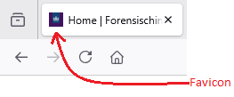

.. _favicon:

Op Favicon Safari
==============================

De onderzoeksvraag voor deze zaak was het vaststellen van het moment dat een bepaalde zoekopdracht is uitgevoerd met een Safari browser op een iPhone. Internetgeschiedenis blijft nog steeds een waardevolle bron van gebruikersactiviteiten. Helaas wordt de internetgeschiedenis vaak door een gebruiker, of na een lange tijd automatisch, verwijderd; zo ook in ons onderzoek. Gelukkig zijn er nog een aantal andere databases van deze browser waar een gebruiker zelf niet iets gemakkelijk uit kan verwijderen, zoals de ``Favicon.db`` database. 

Favicons zijn die kleine icoontjes die je bijvoorbeeld boven in het tabblad van je browser ziet. Safari slaat favicons lokaal op zodat ze niet telkens opnieuw gedownload hoeven te worden en `Favicon.db` is verantwoordelijk voor het registreren van deze informatie.

Als we de database openen zien we de tabel `page_url`, gevuld met URL’s en UUID’s. Ook is de tabel `icon_info` aanwezig, ook gevuld met URL’s, UUID’s… en tijdstempels! De URL’s in deze twee tabellen komen alleen niet met elkaar overeen. De URL’s in de `icon_info` tabel verwijzen naar de download locaties van de favicon zelf. En de URL’s in `page_url` zijn de URL’s die bezocht zijn door de gebruiker. We kunnen deze URL’s en tijdstempels aan elkaar verbinden door middel van de UUID. 

Echter is het niet zo dat elke regel in `page_url`, een tijdstempel van het bezoeken heeft in de `icon_info` tabel. 

Onze zoekopdracht kwam wel voor in de `page_url` tabel maar het tijdstempel dat eraan gelinkt kon worden lag ver na het moment dat we verwachtten. Om een beter beeld te krijgen hoe deze informatie wordt opgeslagen, hebben we een aantal referentie-experimenten uitgevoerd. De resultaten van onze referentie-experimenten kunnen als volgt samengevat worden:

1.	Wanneer een webpagina of specifieker een URL voor het eerst bezocht wordt:
    * wordt in de tabel `icon_info` een regel toegevoegd met daarin een uniek ID voor de favicon, het webadres van de favicon zelf en een tijdstempel van de huidige datum en tijd;
    * wordt een bestandsnaam berekend uit de md5 hash van het unieke ID en daarin wordt de favicon informatie gedownload in een directory naast de database;
    * wordt in de tabel `page_url` een regel toegevoegd met daarin de URL en een verwijzing naar het unieke ID;

2.  Wanneer een URL voor een tweede of volgende keer wordt bezocht:
    * wordt het tijdstempel in `icon_info` niet geüpdatet, tenzij de favicon op de URL is veranderd;
    * Dan wordt het favicon opnieuw gedownload en het tijdstempel in de tabel `icon_info` geüpdatet;
    * Er verandert niets in de tabel `page_url`;

3.	De regels worden op volgorde toegevoegd aan de tabel; de onderste regel in de database is het meest recent toegevoegd.

4.	Unieke URL’s worden toegevoegd aan de `page_url` tabel.

5.	Regels in `page_url` worden gelinkt met icon_info door middel van een uniek ID.

6.	De volgordelijkheid van de URL's in `page_info` verandert niet op het moment dat een pagina voor de tweede keer wordt bezocht.

7.	Per favicon wordt één regel opgeslagen in `icon_info` met de URL naar de locatie van de favicon.

8.	Wanneer een website verschillende favicons gebruikt voor verschillende pagina’s, worden unieke regels voor deze favicons aangemaakt in de `icon_info` tabel.

We zagen in ons onderzoek dat er veel URL’s aan de favicon van Google gelinkt kunnen worden. Het is daarom erg onwaarschijnlijk dat het tijdstempel in `icon_info` hoort bij het moment dat onze zoekopdracht is uitgevoerd. 

Wat we wel kunnen doen is naar omliggende regels kijken. Wanneer er UUID’s zijn die maar één keer voorkomen in de tabel, weten we zeker dat het tijdstempel dat erbij geregistreerd is, ook het moment is dat deze pagina bezocht is. De tussenliggende regels moeten in de tussenliggende periode geschreven zijn. Door deze methode toe te passen in ons onderzoek was een periode op te stellen van minder dan 24 uur waar binnen de zoekopdracht uitgevoerd moet zijn.
