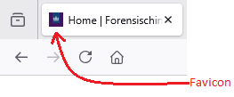

.. _favicons:

Going on a Favicon Safari
==============================

During an investigation, the main question for us was to establish the timeframe of certain internet search queries. The queries were done using the Safari browser on an iPhone. Internet history is still a valuable source for identifying user activity. Unfortunately however, the internet history oftentimes gets deleted by a user, or is deleted automatically after a certain amount of time. In our investigation the history was not present anymore. Luckily, there are other Safari databases recording data a user cannot easily delete. Such a database is the ``Favicon.db`` database.

Favicons are the small icons you can see on the tab of the browser. Safari saves the favicons locally, so they don't have to be downloaded again and again. The database `Favicon.db` is responsible for registering this information.

Inside the database we can see the table ``page_url``, which contains URLs and UUIDs. Another table is called ``icon_info``, containing both ULRs and UUIDs... and timestamps! However, the URLs in these two tables do not match. The URLs in table `icon_info` refer to the download locations of the favicons. The URLs in table `page_url` are visited by the user. We can find a link between these URLs by comparing their UUIDs.

However, not all records in table `page_url` can be related to the time of visiting a URL.

Our search query was present in table `page_url`, but the timestamp that was linked to it wasn't the timestamp we expected. To create a better understanding on how this information is stored, we conducted a few experiments. The results of these experiments can be summarized as follows:

1.  When a website (or more specifically a URL) is visited for the first time:

    * A record is added to table `icon_info` containing a UUID for the favicon, the web address of the favicon and the current timestamp;
    * The favicon is downloaded to disk, using the MD5-hash of the UUID as file name;
    * A record is added to table `page_url` containing the URL and the UUID.

2.  When a URL is re-visited:

    * No changes are seen in table `page_url`;
    * The timestamp in table `icon_info` is only updated when the favicon itself is updated;
    * The favicon is downloaded to disk again if the favicon has changed.
    
3.  Records are appended to the tables; the last records in the table are added most recently.

4.  Unique URLs are stored in table `page_url`

5.  Records in table `page_url` are linked to records in table `icon_info` by UUID.

6.  The order of URLs in table `page_info` remains unchanged when re-visiting a URL.

7.  Per favicon one records is stored in table `icon_info`, containing the URL to the location of the favicon.

8.  In case a website uses multiple favicons for different web pages, unique records are stored in table `icon_info`.

In our research, we have seen a number of URLs linked to the favicon of Google. Therefore it is highly unlikely that the timestamp as found in table `icon_info` corresponds to the moment of the search query.

What we can do is analyzing the surrounding records in the table. When two UUIDs are found that occur only once, we can deduce the moment the corresponding websites are visited. Records in between these two records are bound to be written to the table between these two moments. By using this method, we were able to specify a period of time (of 24 hours) in which the search query must have been performed.
