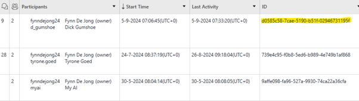

.. _snapchat_photos_sqlite:

Photos.sqlite: Your friend during a Snapchat video origin investigation
==============================

Investigations into the origin of media files come up in many cases. You can often get a long way by looking at
chat messages, the location of the file, or other metadata present on the device. However, apps that delete
information after a certain period are becoming increasingly popular. As a result, most forensic tools also lose the
association between a media file and the app.

On Apple devices, the file `/private/var/mobile/Media/PhotoData/Photos.sqlite` can be useful here. This is the database
of the Photos app, containing the metadata for the photos and videos (from, among other places, the DCIM folder).
Among other things, the database records which app added the media file to the database, when the media file was added
and much more. Example queries for the Photos.sqlite database can be found at:

.. _iOS Local PL Photos.sqlite Queries: https://github.com/ScottKjr3347/iOS_Local_PL_Photos.sqlite_Queries.

The Photos.sqlite database can therefore be used to determine which app a media file came from, but it does not tell
you whether the file itself was created, sent, received or only viewed. During one investigation, however, we noticed
that the `ZORIGINALFILENAME` column in the `ZCLOUDMASTER` table contained several different kinds of file names, all
originating from Snapchat. This led to the idea that `ZORIGINALFILENAME` might indicate how the file ended up on the phone.

The results may look promising, but there is still a great deal that has not yet been researched. Examples
include videos that were received (via Snapchat or other channels) and then (re)shared via Snapchat, stories
(your own and other people’s) that are shared and then downloaded, and photos.
We  urge you to treat the results below with caution. If an original file name in a case matches one of the
results, this does not mean the video file ended up on the phone that way; it is only one of the possibilities.

To investigate our hypothesis, several experiments were carried out, varying:

-	an iPhone or Android device as the other party,

-	creating and sending a video or receiving a video,

-	recording the video with the native (iPhone or Android) camera or with the Snapchat camera,

-	whether or not a filter was applied, and

-	recording the video with the front or rear camera of the phone.

Based on the results so far, the ZORIGINALFILENAME column appears to help distinguish between received and sent videos:

- Videos recorded on the user’s own device with the native iPhone camera and then saved to Photos get an original
  file name of the form `cm-chat-media-video-<UID>.mov`.

- Videos recorded on the user’s own device with the Snapchat camera and then saved to Photos get an original file
  name of the form `cm-chat-media-video-<own_account>~<UID>.mov`.

- For videos recorded with the native camera and edited in Snapchat with a filter, the app asks whether the user
  wants to save the edited version. The user then has the choice between overwriting the original file or saving a copy.
  If the user chooses to save a copy, the video gets an original file name of the form `filtered-<UID>.mp4`.
  Experiments with overwriting the file have yet to be carried out.

- | Videos recorded on another device with the native camera or the Snapchat camera and then saved to Photos get an
    original file name of the form `cm-chat-media-video-1:<conversation-ID>:<message_number_within_conversation>:0:0.mov`.
  | In case data, we have also seen the zeros before the .mov change to 1s. We have not yet been able to reproduce this
    in our experiments.

In UFED, the conversation ID can be found in the Snapchat chat overview:

As mentioned earlier, there is still a lot to figure out. We will share additional results once we have them.
